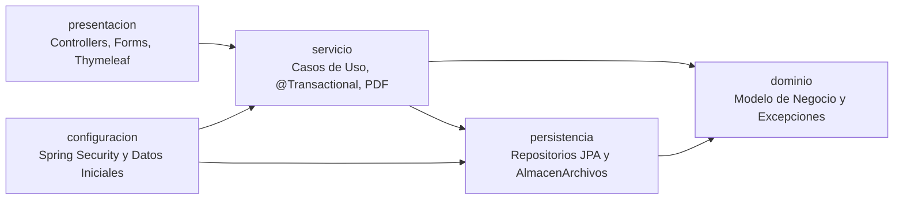

# Plataforma SQA (`plataforma-sqa`)


Plataforma web para el monitoreo, gestión y trazabilidad de actividades de **Aseguramiento de la Calidad de Software (SQA)**, desarrollada en **Java 17** y **Spring Boot** como proyecto del Programa Académico de Ingeniería de Software (**UAZ -- UAIE / PAIS**).

El sistema funciona como un centro de control para equipos de desarrollo: permite organizar proyectos por periodo, configurar métricas con umbrales tipo semáforo, dar seguimiento a técnicas de SQA con evidencias verificables (URL o PDF) y exportar reportes ejecutivos de salud del software en formato PDF.

---

## Tabla de Contenidos

1. [Funcionalidades Principales](#funcionalidades-principales)
2. [Arquitectura y Diseño](#arquitectura-y-diseño)
3. [Tecnologías Utilizadas](#tecnologías-utilizadas)
4. [Estructura del Repositorio](#estructura-del-repositorio)
5. [Instalación y Ejecución](#instalación-y-ejecución)
   - [Con Docker Compose (Recomendado)](#opción-1-docker-compose-recomendado)
   - [Ejecución Local con Maven](#opción-2-ejecución-local-con-maven)
   - [Ejecución mediante `.jar` empaquetado](#opción-3-ejecución-mediante-archivo-jar)
6. [Roles y Datos de Prueba](#roles-y-datos-de-prueba)
7. [Pruebas, Cobertura y CI/CD](#pruebas-cobertura-y-cicd)
8. [Evidencias de Calidad (SQA)](#evidencias-de-calidad-sqa)
9. [Equipo de Desarrollo](#equipo-de-desarrollo)

---

## Funcionalidades Principales

La versión **v1.0** implementa los requisitos funcionales (`RS-01` a `RS-11`) y no funcionales (`RNF-01` a `RNF-07`) especificados en el SRS:

- **Gestión de Proyectos por Periodo (`CU01` | `RS-01`, `RS-02`):**
  - Registro, edición y consulta de proyectos agrupados por etiqueta de periodo (`Periodo`).
  - Validación de unicidad por periodo y consistencia estricta de rangos de fechas (`fechaInicio` y `fechaFin`), protegida ante peticiones concurrentes.
- **Métricas de Calidad e Histórico de Mediciones (`CU02`, `CU03` | `RS-03` a `RS-05`):**
  - Definición de métricas cuantitativas por proyecto con unidad de medida, frecuencia, sentido de evaluación y umbrales de semáforo (`VERDE`, `AMARILLO`, `ROJO`).
  - Registro histórico auditable de mediciones con autor y marca de tiempo, acompañado de gráficas de tendencia.
- **Gestión de Técnicas y Métodos SQA (`CU04` | `RS-06` a `RS-08`):**
  - Asignación de técnicas categorizadas con responsables verificados y flujo de estados (`PENDIENTE`, `EN_PROGRESO`, `APLICADO`).
  - Bitácora de transiciones y validación obligatoria de evidencia (URL o archivo PDF adjunto), con limpieza diferida de archivos reemplazados tras confirmar la transacción (`afterCommit`).
- **Dashboard y Reportes de Salud en PDF (`CU05`, `CU06` | `RS-09` a `RS-11`):**
  - Cálculo consolidado del índice global de salud y dictamen del proyecto (`CalculadoraSalud`).
  - Exportación en formato PDF (`GeneradorReportePdf`) con el resumen de métricas, historial de mediciones y evidencias verificadas.
- **Seguridad Basada en Roles:**
  - Autenticación y control de acceso con Spring Security para los perfiles `LIDER`, `SQA` y `DESARROLLADOR`.

---

## Arquitectura y Diseño

El paquete principal `mx.uaz.sqa` sigue una **arquitectura en capas estricta**, verificada automáticamente en cada compilación mediante **ArchUnit** (`ArquitecturaCapasTest`):



| Paquete | Responsabilidad |
| :--- | :--- |
| `mx.uaz.sqa.presentacion` | Controladores Spring MVC, formularios, gráficas de tendencia y vistas Thymeleaf. |
| `mx.uaz.sqa.servicio` | Orquestación de casos de uso, fronteras transaccionales, DTOs y generador de reportes PDF. |
| `mx.uaz.sqa.dominio` | Entidades, objetos de valor (`Periodo`, `Umbrales`, `Evidencia`, `IndiceSalud`) y excepciones de negocio. |
| `mx.uaz.sqa.persistencia` | Repositorios Spring Data JPA y almacenamiento físico local de evidencias (`AlmacenArchivosLocal`). |
| `mx.uaz.sqa.configuracion` | Seguridad (`SeguridadConfig`), autenticación y precarga de datos iniciales (`CargadorDatosIniciales`). |

---

## Tecnologías Utilizadas

| Categoría | Stack |
| :--- | :--- |
| **Backend** | Java 17, Spring Boot, Spring MVC, Spring Security, Spring Data JPA |
| **Frontend** | Thymeleaf, HTML5, CSS3, JavaScript |
| **Base de Datos** | MySQL 8.0 (perfil `mysql` en Docker) / H2 (ejecución local y pruebas) |
| **Contenedores** | Docker (build multi-etapa con usuario no privilegiado `UID 10001`), Docker Compose |
| **Calidad y CI** | JUnit 5, Mockito, ArchUnit, JaCoCo, SonarCloud, GitHub Actions |

---

## Estructura del Repositorio

```text
repoCalidad/
├── .github/
│   ├── ISSUE_TEMPLATE/          # Plantillas de reporte de defectos y requisitos
│   ├── pull_request_template.md # Checklist de revisión de código (IEEE Std 1028)
│   └── workflows/ci.yml         # Pipeline CI: pruebas, ArchUnit, JaCoCo y SonarCloud
├── plataforma-sqa/              # Código fuente de la aplicación Spring Boot
│   ├── Dockerfile               # Construcción multi-etapa (Maven 3.9.9 -> Temurin 17 JRE)
│   ├── docker-compose.yml       # Orquestación de MySQL 8.0 + plataforma-sqa
│   ├── pom.xml                  # Dependencias, plugins y umbral de cobertura JaCoCo
│   └── src/
│       ├── main/                # Código fuente, plantillas Thymeleaf y recursos estáticos
│       └── test/                # Pruebas unitarias, arquitectura, concurrencia e integración
├── qa-evidence/                 # Repositorio de auditoría y evidencias SQA
│   ├── bitacora-sqa.md
│   ├── matriz-pruebas-aceptacion.md
│   ├── cobertura/
│   ├── pruebas/
│   └── sonar/
└── README.md
```

---

## Instalación y Ejecución

### Opción 1: Docker Compose (Recomendado)

Levanta automáticamente la base de datos **MySQL 8.0** y la aplicación **Plataforma SQA** sin necesidad de instalar Java, Maven ni MySQL en tu equipo.

**Requisitos:** Docker y Docker Compose.

1. Clona el repositorio y entra al directorio de la aplicación:
   ```bash
   git clone https://github.com/BenduOlo253/repoCalidad.git
   cd repoCalidad/plataforma-sqa
   ```
2. Construye las imágenes y levanta los contenedores:
   ```bash
   docker compose up --build -d
   ```
3. Verifica que los contenedores (`sqa-mysql` y `sqa-app`) estén en ejecución:
   ```bash
   docker ps
   ```
4. Abre la plataforma en tu navegador:
   ```text
   http://localhost:8081
   ```
   > **Nota:** El servicio se expone en el puerto local `8081` (mapeado al `8080` del contenedor) para evitar colisiones con otros servicios locales. Los archivos PDF de evidencias se persisten en `./data/evidencias`.

Para detener y limpiar los contenedores:
```bash
docker compose down
```

---

### Opción 2: Ejecución Local con Maven

**Requisitos:** JDK 17 y Maven 3.9+.

```bash
cd plataforma-sqa
mvn spring-boot:run
```

La aplicación quedará disponible en:
```text
http://localhost:8080
```

---

### Opción 3: Ejecución mediante archivo `.jar`

Si descargaste el archivo `.jar` desde la sección **Releases** de GitHub o lo compilaste manualmente (`mvn clean package -DskipTests`):

- **Con configuración por defecto:**
  ```bash
  java -jar plataforma-sqa.jar
  ```
- **Conectado a una instancia local de MySQL:**
  ```bash
  java -jar plataforma-sqa.jar \
    --spring.profiles.active=mysql \
    --spring.datasource.url=jdbc:mysql://localhost:3306/plataforma_sqa?createDatabaseIfNotExist=true&serverTimezone=America/Mexico_City \
    --spring.datasource.username=root \
    --spring.datasource.password=TU_CONTRASEÑA
  ```

---

## Roles y Datos de Prueba

Al iniciar con una base de datos vacía, `CargadorDatosIniciales` precarga usuarios y datos de ejemplo para probar los distintos niveles de acceso:

| Rol | Alcance en la Plataforma |
| :--- | :--- |
| **`LIDER`** | Administración completa de proyectos, métricas, técnicas, evidencias y reportes. |
| **`SQA`** | Configuración y seguimiento de métricas, captura de mediciones, gestión de técnicas y exportación de reportes. |
| **`DESARROLLADOR`** | Consulta de proyectos, dashboard de salud y acciones permitidas según `SeguridadConfig`. |

Las credenciales de demostración pueden consultarse en `plataforma-sqa/src/main/java/mx/uaz/sqa/configuracion/CargadorDatosIniciales.java`.

---

## Pruebas, Cobertura y CI/CD

El desarrollo y validación siguen prácticas alineadas con **IEEE Std 730-2014**, **IEEE Std 1028** e **ISO/IEC 29119**.

Para ejecutar la suite completa de pruebas (unitarias, arquitectura, concurrencia e integración) y verificar el umbral mínimo de cobertura del **70%** con **JaCoCo**, ejecuta dentro de `plataforma-sqa/`:

```bash
mvn verify
```

El pipeline de **GitHub Actions** (`.github/workflows/ci.yml`) ejecuta automáticamente en cada push o Pull Request:
1. Compilación y ejecución de toda la suite de pruebas (`JUnit 5` + `ArchUnit`).
2. Generación del reporte de cobertura `JaCoCo` y publicación del artefacto `evidencia-calidad`.
3. Análisis estático y verificación del Quality Gate en **SonarCloud** (`BenduOlo253_sqa`).

---

## Evidencias de Calidad (SQA)

Todos los artefactos de verificación del proyecto están organizados en [`qa-evidence/`](qa-evidence/) y `.github/`:
- **Bitácora SQA:** [`qa-evidence/bitacora-sqa.md`](qa-evidence/bitacora-sqa.md)
- **Matriz de pruebas de aceptación:** [`qa-evidence/matriz-pruebas-aceptacion.md`](qa-evidence/matriz-pruebas-aceptacion.md)
- **Reportes de cobertura y análisis estático:** [`qa-evidence/cobertura/`](qa-evidence/cobertura/) y [`qa-evidence/sonar/`](qa-evidence/sonar/)
- **Plantilla de revisión de Pull Requests (IEEE Std 1028):** [`.github/pull_request_template.md`](.github/pull_request_template.md)

---

## Equipo de Desarrollo

**ACME Incorporated** -- Programa Académico de Ingeniería de Software (UAZ / UAIE / PAIS):

- José Manuel Roberto Badillo
- Víctor Alejandro Escobedo Torres
- Valeria González Alvarado
- Aarón de Jesús Reyes Galdino

---

*Release v1.0 -- Noviembre de 2026*